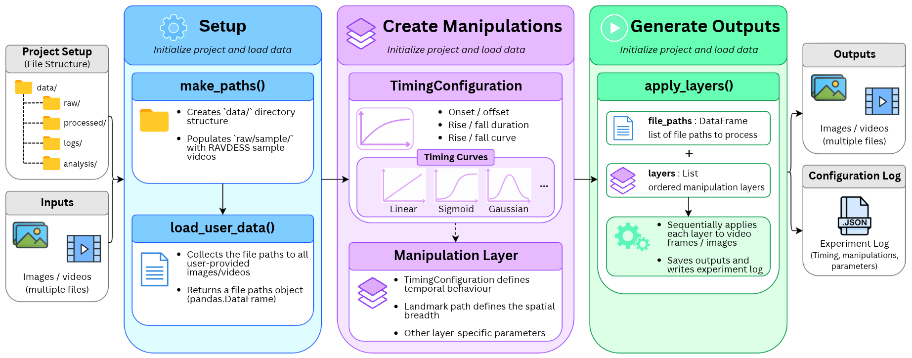

# Getting Started

## Installing PyFAME

PyFAME requires Python version >= 3.9 and <= 3.13 to be installed on your system. You can find information on installing and setting up Python [here](https://www.python.org/downloads/). Once you have Python installed, PyFAME can be installed with pip via PyPi:

```sh
pip install pyfame
```

## Quick Start

Get started producing a complete image and video manipulation pipeline with only 5 lines of code:

```python
import pyfame as pf

# Create the necessary file system structure to load and organize data
pf.make_paths()

# Get dataframe of file paths, pre-loaded with sample data
files = pf.load_sample_data()

# Create your manipulation layer
layer_recolour = pf.layer_colour_recolour()

# Apply your layer to your file paths
pf.apply_layers(file_paths = files, layers = layer_recolour)
```

---
<div align="center" markdown>

## PyFAME's Workflow

</div>
<div align="center">
    
</div>

If this is your first time using PyFAME, your first step is to call the `make_paths()` function. This will create all of the necessary project structure within the projects working folder (typically named `data/`, but can be user-specified), namely the `raw/` and `processed/` subdirectories will contain all of the pre, and post-manipulation files respectively. Additionally, you may automatically populate the `raw/` subdirectory with several sample videos by setting parameter `load_sample_data` = `True`. `make_paths()` only needs to be called once when first setting up your project.

Generally, most PyFAME scripts will begin with loading in your data using either `load_user_data()` or `load_sample_data()`. These functions will return a pandas DataFrame containing relative and absolute file paths to all of the files from the specified folder (defaults to `raw/`).

After retrieving the file paths, the next step is to define and parametrize your manipulation layers. An optional TimingConfiguration object can be defined and passed to each layer for precise temporal control, but by default all layers will perform their manipulation at 100% strength for the duration of the video.

Lastly, to apply your manipulation layers to your files, pass both the file_paths object and one or more layers to the `apply_layers()` function. Additionally, users may pass the file_paths directly to an analysis function (i.e. `analyse_optical_flow()`).

!!! info
    If you would like to see more specific examples or tutorials, check out the [Examples](../examples/index.md)