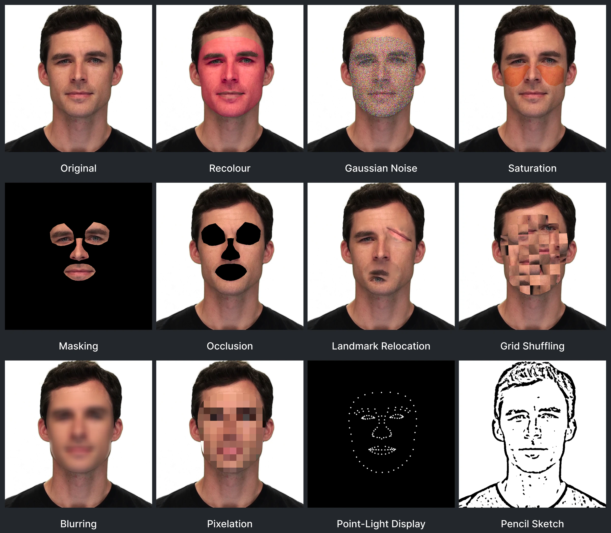

---
hide:
  - navigation
  - toc
---

    
        &gt;_
    
    <code>pip install pyfame</code>

# Controlled facial manipulations over image and video

    The Python Facial Analysis and Manipulation Environment
    provides an open-source toolkit for creating reproducible
    facial manipulations in affective computing, computer vision,
    psychology, and neuroscience tasks.

 

[What Is PyFAME?](getting-started/about-pyfame.md){ .md-button .md-button--primary }
[Getting Started](getting-started/index.md){ .md-button }
[GitHub](https://github.com/affectivedatascience/PyFAME){ .md-button }

    

-   
    **Manipulation Layering**

    ---

    Combine several manipulations into a single processing call.

-   
    **Temporal Modulation**

    ---

    Precisely control a manipulations onset, offset and strength at any given moment.

-   
    **Precise Regional Application**

    ---

    Access 478 facial landmarks for targeted regional application.

